<!-- Drawn by scripts/build.py and redrawn every day by .github/workflows/build.yml: change the script, not this file. -->

<a href="https://portfolio.princdev.com"><picture><source media="(prefers-color-scheme: dark)" srcset="assets/hero-dark.svg"></picture></a> <a href="https://portfolio.princdev.com"><picture><source media="(prefers-color-scheme: dark)" srcset="assets/pill-portfolio-dark.svg"></picture></a> <a href="https://www.linkedin.com/in/roman-princ-717a58244/"><picture><source media="(prefers-color-scheme: dark)" srcset="assets/pill-linkedin-dark.svg"></picture></a> <a href="mailto:roman.princ00@gmail.com"><picture><source media="(prefers-color-scheme: dark)" srcset="assets/pill-email-dark.svg"></picture></a> <a href="https://wingmanfares.com"><picture><source media="(prefers-color-scheme: dark)" srcset="assets/pill-wingman-dark.svg"></picture></a> <a href="https://wingmanfares.com"><picture><source media="(prefers-color-scheme: dark)" srcset="assets/wingman-dark.svg"></picture></a><a href="https://portfolio.princdev.com/work/powderline"><picture><source media="(prefers-color-scheme: dark)" srcset="assets/powderline-dark.svg"></picture></a><a href="https://portfolio.princdev.com/work/chester-iot"><picture><source media="(prefers-color-scheme: dark)" srcset="assets/chester-dark.svg"></picture></a><a href="https://portfolio.princdev.com/work/image-editor"><picture><source media="(prefers-color-scheme: dark)" srcset="assets/image-editor-dark.svg"></picture></a><a href="https://portfolio.princdev.com/work/excel-engine"><picture><source media="(prefers-color-scheme: dark)" srcset="assets/excel-engine-dark.svg"></picture></a><a href="https://portfolio.princdev.com/#about"><picture><source media="(prefers-color-scheme: dark)" srcset="assets/toolbox-dark.svg"></picture></a><a href="https://github.com/roman-princ?tab=repositories"><picture><source media="(prefers-color-scheme: dark)" srcset="assets/activity-dark.svg"></picture></a><a href="mailto:roman.princ00@gmail.com"><picture><source media="(prefers-color-scheme: dark)" srcset="assets/footer-dark.svg"></picture></a>

